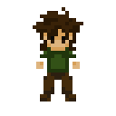
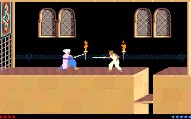
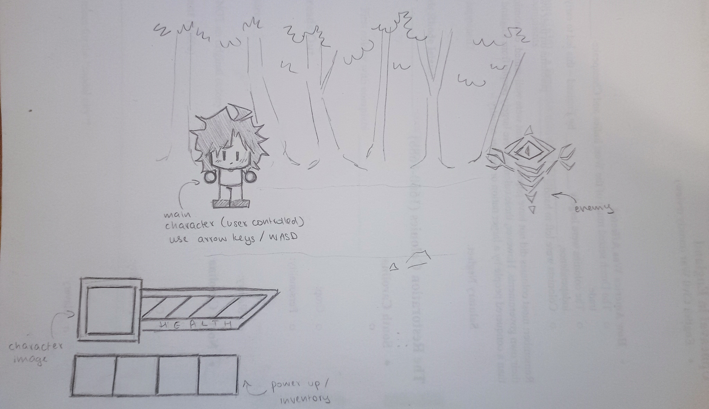

# Game Dev: Group 3

### Forest of Beasts 

## Player: 
The player is an unnamed fighter.

## Goal: 
The goal of the game is for the player to kill all of the enemies they're fighting, progress through the forest, and to defeat the boss at the end. 
## Core action: 
The gameplay loop is fighting enemies and progressing to the next one (in a linear fashion).
## Challenge: 
Health system that decreases when hit, meaning that the enemies can kill you. 
## Feedback: 
There will be meters showing health that decrease when you're hit. 
## Scope: 
Hitting and killing one enemy. 
## Perspective:
The game will be 2D, in 3rd person view. 

## Game:
The player’s goal is to kill all of the enemies without dying. 

The player moves with the arrow keys, and clicks to attack. 

The challenge in this game are enemies the player has to fight.

Feedback is given by health bars that show both the player and enemy health.

We should figure out how to implement the animations for attacks, and how to keep the enemies progressing naturally until you reach a boss. 

# Game Inspiration/Example:

Prince of Persia

________________________

# GUI Mockup: 
 
_______________________
### Pitch Document

([Pitch Document (Group 3)](https://docs.google.com/document/d/1uviuY880l4IykHoEFrVYQckRX1fBgzq2PkLnaWorPt4/edit?tab=t.0)) 
