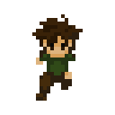
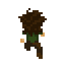
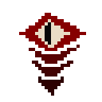
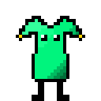
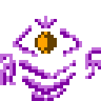
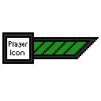
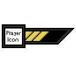
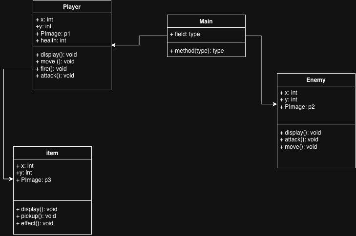

# Game Dev: Group 3

### Forest of Beasts 

## Player: 
The player is an unnamed fighter.

%20in%20128%20pixels.gif?raw=true)
%20in%20128%20pixels.gif?raw=true)

## Goal: 
The goal of the game is for the player to kill all of the enemies that get in their way, progress through the entire forest, and to eventually defeat the boss at the end of the game. 
### Enemies:

## Core action: 
The core gameplay loop is fighting enemies, picking up items/power-ups,  and progressing to the next area in the forest when all of the enemies have been killed.
## Challenge: 
The challenge of the game is a health system that decreases when the player is hit, meaning that the enemies can kill you and you would have to start over. 

## Feedback: 
There will be icons on the bottom half of the screen, showing a health bar that decreases when you're hit. 

If we have enough time, there will be a small inventory for items and power-ups shown on the screen as well. 
## Scope: 
Hitting and killing one enemy. 
## Perspective:
The game will be 2D, in 3rd person view. It will either be a side scroll, or have enemies coming from any direction at the player. 

## Game:
* The player’s goal is to kill all of the enemies without dying. 

* The player moves with the arrow keys, and clicks to attack. 

* The challenge in this game are enemies the player has to fight.

* Feedback is given by health bars that show both the player and enemy health.

* We should figure out how to implement the animations for attacks, and how to keep the enemies progressing naturally until you reach a boss. 

# Game Inspiration/Example:

Prince of Persia

________________________

## GUI Mockup: 
(Zoe Abraham) 

 
_______________________
## Pitch Document: 
(Alan Huang) 

[Pitch Document (Group 3)](https://docs.google.com/document/d/1uviuY880l4IykHoEFrVYQckRX1fBgzq2PkLnaWorPt4/edit?tab=t.0)
_______________________
## Class Diagram: 
(Gideon Gordon)

_______________________
### Class Shells

Diana:

Responsible for the item class. This class has to give the player items and powerups to use throughout the run. It is tied to the enemy and player classes, as it drops when an enemy dies, and needs to be pick up by a player to use. 
